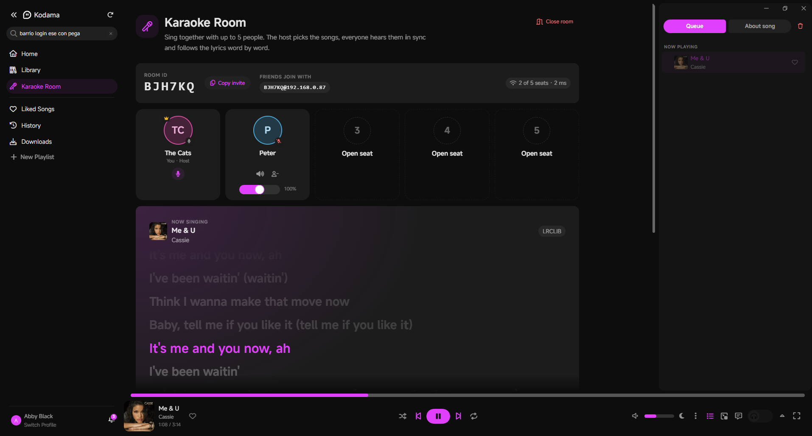
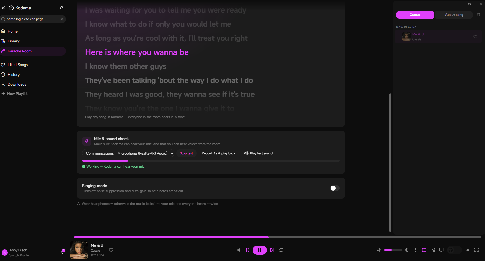
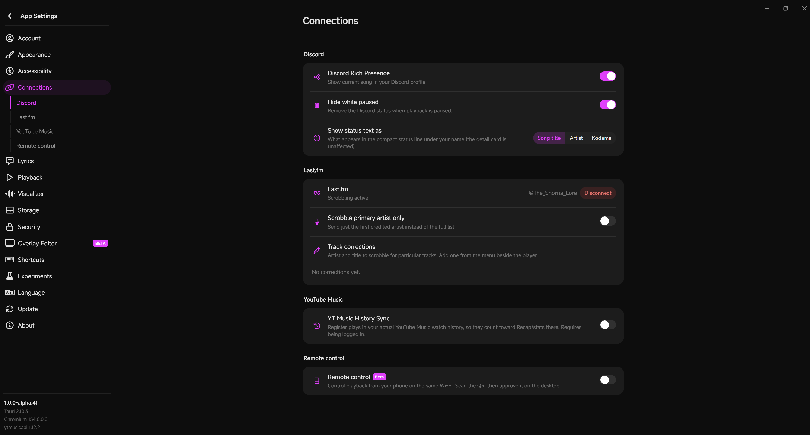

<div align="center">
  
  <h3>Kodama — with Live Karaoke Room 🎤</h3>
  <p>An unofficial desktop player for YouTube Music, plus rooms where up to 5 friends sing together.</p>

  [](LICENSE)
  [](#download)
  [](https://tauri.app)
</div>

---

## Credit where credit's due

This is a **fork** of **[Kodama](https://github.com/KiyoshiTheDevil/Kodama)** by
**[KiyoshiTheDevil](https://github.com/KiyoshiTheDevil)**. The player, the lyrics engine,
downloads, the remote, the OBS overlay — all of Kodama itself — is their work. Please support
the original project, and report bugs that aren't about Karaoke Room to them
([Discord](https://discord.gg/rhreShDJxn)).

What this fork adds is **Live Karaoke Room** (and its mic & sound check). Nothing else in Kodama
was removed or changed.

Also used:
- [bgutil-ytdlp-pot-provider](https://github.com/Brainicism/bgutil-ytdlp-pot-provider) by Brainicism — helps YouTube streams play (same as official Kodama)
- [yt-dlp](https://github.com/yt-dlp/yt-dlp), [ytmusicapi](https://github.com/sigma67/ytmusicapi), [Tauri](https://tauri.app) and the other open-source libraries Kodama is built on

> **AI notice:** like Kodama itself, which was made with Claude Code, the Karaoke Room in this fork
> was written with the help of an AI (Claude). If you're against AI-assisted software, this fork
> won't be for you.

---

## What's new: Live Karaoke Room

<p align="center">
  
  <br><sub>The room page: seats, invite and live synced lyrics</sub>
</p>

<p align="center">
  
  <br><sub>Mic &amp; sound check: pick your mic, see the level, record and play back</sub>
</p>

- 🎤 **Rooms for up to 5 people.** Create a room, get a 6-character Room ID, share it. A 6th
  person is told the room is full.
- 🎶 **The host picks the music.** Whatever the host plays, everyone hears at the same time on
  their own Kodama. Play, pause, skip and seeking all follow the host.
- 📝 **Synced lyrics for everyone,** with each word lighting up as it's sung (when the song has
  word-synced lyrics).
- 🗣️ **Live voice chat** so you can sing and talk over the music. No text chat, by design.
  - Mute / unmute your own mic (everyone sees your mic state)
  - Mute anyone just for yourself, and a volume slider for each person (0–200 %)
  - The host can remove people
  - **Singing mode** stops the mic filter from cutting off long held notes
- 🪟 **Room overlay** on every page: the 5 seats with live voice meters, your mic button and the
  current lyric line. Drag it, collapse it, or open the full room page.
- ✅ **Mic & sound check:** pick your microphone, see a live level meter, record yourself and play
  it back, or play a test chime (works without a mic). If the mic won't start, it tells you why.

**Privacy:** voices go directly between the people in the room (peer-to-peer). They don't pass
through any server, and nothing is recorded. The host's Kodama only passes along room setup,
playback position and lyrics, and only to people who have the Room ID.

Everything else is regular Kodama: synced lyrics with word/syllable timing, Unison community
lyrics, the Lyrics Composer, crossfade, visualizer, phone remote, OBS overlay, offline downloads,
Discord Rich Presence and Last.fm scrobbling.

---

## Download

Get **`Kodama_..._x64-setup.exe`** from this fork's
[**Releases**](../../releases) page and run it.

- Windows will say **"Windows protected your PC"** because the installer isn't code-signed.
  Click **More info → Run anyway**.
- When Windows Firewall asks about Kodama, tick **Private networks** and click **Allow**.
  Friends can't join your rooms without this.
- Already have official Kodama? This installs over it.

> **Everyone in a room needs this fork installed.** Official Kodama doesn't have Karaoke Room.

---

## How to use Karaoke Room

### Before you start
- **Wear headphones.** Otherwise the music leaks into your mic and everyone hears it twice.
- **Be on the same network** (same router — Wi-Fi or cable). For friends somewhere else, see
  [Friends in other places](#friends-in-other-places).
- **Test your mic:** sidebar → **Karaoke Room** → **Mic & sound check** → **Test mic**, then talk.
  The bar should move and it should say *"Working — Kodama can hear your mic."*
  No mic? Press **Play test sound** — if you hear a chime, you'll hear the room.

### Host a room
1. Sidebar → **Karaoke Room** → **Create a room**.
2. Type your name → keep **This computer** selected → **Create room**.
3. Click **Copy invite** and send it to your friends. It looks like `U4ED2T@192.168.1.20`.
4. Play any song in Kodama. Everyone in the room hears it with you.

### Join a room
1. Sidebar → **Karaoke Room** → **Join by ID**.
2. Paste the whole invite into **Room ID** (it fills in the host address by itself).
3. Type your name → **Join room**.
4. Your player now follows the host. Use the mic button to talk or sing.

### Friends in other places
Install **[Tailscale](https://tailscale.com)** (free) on every PC and sign everyone into the same
Tailscale network. It works like being on one home network. The host then shares the invite with
their **Tailscale IP** after the `@` (it starts with `100.` and is shown in the Tailscale app),
for example `U4ED2T@100.101.102.103`.

> Don't forward port 9847 on your router or put it behind a tunnel — that would open more of
> Kodama to the internet than just the rooms.

### If something doesn't work

| Problem | Fix |
|---|---|
| "Couldn't reach the host" | Host must be in a room, both PCs on the same network (or Tailscale). On the host: Windows Security → Firewall & network protection → **Allow an app through firewall** → tick **kodama-server** for **Private**. Also check Settings → Network & internet → your network is set to **Private**. |
| "That room is full" | 5 people is the maximum. |
| Your mic doesn't work | Use **Mic & sound check** — it shows the reason. Usually: Settings → Privacy & security → **Microphone** → turn on all three switches (including *Let desktop apps access your microphone*), or close Discord/Zoom/OBS, which can hold the mic. |
| You can't hear someone | Check their seat card: the speaker icon shouldn't be crossed out and the slider shouldn't be at 0 %. Play the **test sound**. Check Windows' Volume mixer: every *Kodama* entry should be unmuted. Voices play on Windows' **default** output device. |
| Echo / feedback | Headphones, on everyone. |
| A song won't play for one person | It may be region-locked or Premium-only for their account. |

---

## Build it yourself (Windows)

You don't need this to *use* the app — only if you want to build the installer yourself.
These are exactly the steps I used. It takes about an hour the first time, mostly waiting.

### 1. Install the tools

You need five things. Install them in this order, then **restart your PC** once at the end.

| Tool | What it's for | Where to get it | How to install |
|---|---|---|---|
| **Visual Studio 2022** (Community or Build Tools) | The C++ compiler Rust uses | [visualstudio.microsoft.com/downloads](https://visualstudio.microsoft.com/downloads/) | In the installer, tick **"Desktop development with C++"** and install. Already have Visual Studio? Open *Visual Studio Installer* → **Modify** → make sure that box is ticked. *(VS **Code** is a different program and isn't enough.)* |
| **Rust** | Builds the app's core | [rust-lang.org/tools/install](https://www.rust-lang.org/tools/install) | Download **rustup-init.exe (64-bit)**, run it, press **1** and Enter. |
| **Node.js** (version 22.12 or newer) | Builds the app's screens | [nodejs.org](https://nodejs.org) | Download the **LTS** "Windows Installer (.msi)" and click Next through it. |
| **Python 3.11** | Kodama's background server | [python.org/downloads](https://www.python.org/downloads/) | Run the installer and **tick "Add python.exe to PATH"** on the first screen. |
| **Git** | Downloads one extra component | [git-scm.com](https://git-scm.com/download/win) | Click Next through it (defaults are fine). |

**Check everything is installed:** open **PowerShell** (Start menu → type *PowerShell*) and run
these one at a time. Each should print a version number.

```powershell
rustc -vV
node -v
python --version
git --version
```

- `rustc -vV` must show **`host: x86_64-pc-windows-msvc`**.
- `node -v` must be **v22.12.0 or higher** (v24 is fine).
- If something says *"not recognized"*, close PowerShell, open a new one and try again. Still
  nothing? Reinstall that tool.

### 2. Get the code

Either click the green **Code** button on this page → **Download ZIP** and extract it, or clone
it with GitHub Desktop. Put it in a short path **without spaces**, for example
`C:\dev\Kodama-Karaoke`. Then in PowerShell:

```powershell
cd C:\dev\Kodama-Karaoke
```

(Use your own folder path. Every command below runs from this folder unless it says otherwise.)

### 3. Install the app's packages

```powershell
npm ci
```

Use `npm ci`, **not** `npm install` — `ci` installs the exact versions the app was tested with.

### 4. Set up Python

```powershell
cd python-backend
python -m venv .venv
.venv\Scripts\Activate.ps1
pip install -r requirements.txt pyinstaller
```

If you get *"running scripts is disabled on this system"*, run this once and then repeat the
`Activate.ps1` and `pip install` lines:

```powershell
Set-ExecutionPolicy -Scope CurrentUser RemoteSigned
```

When it works, your PowerShell line starts with `(.venv)`.

### 5. Build Kodama's background server

Still in `python-backend`, with `(.venv)` showing:

```powershell
pyinstaller kodama-server-x86_64-pc-windows-msvc.spec --distpath ..\src-tauri\binaries --workpath build_tmp
cd ..
```

Takes a few minutes. Afterwards `src-tauri\binaries\kodama-server-x86_64-pc-windows-msvc.exe`
must exist.

### 6. Download the Node runtime Kodama ships with

```powershell
mkdir src-tauri\resources -Force
Invoke-WebRequest https://nodejs.org/dist/v22.18.0/win-x64/node.exe -OutFile src-tauri\resources\node.exe
```

### 7. Build the PO-token generator

This is the same helper (version 1.3.1) official Kodama bundles so YouTube streams play.

```powershell
git clone --single-branch --branch 1.3.1 --depth 1 https://github.com/Brainicism/bgutil-ytdlp-pot-provider.git potgen-src
cd potgen-src\server
npm ci
npx tsc
npm prune --omit=dev
mkdir ..\..\src-tauri\resources\potgen\server -Force
Copy-Item build, package.json, node_modules -Destination ..\..\src-tauri\resources\potgen\server -Recurse -Force
cd ..\..
```

Check that `src-tauri\resources\potgen\server\build` exists.

### Optional: Last.fm sign-in for your users

Skip this if you don't need Last.fm (it will show *"Not configured"*). Otherwise, set up the
free signing service in **[lastfm-signer/README.md](lastfm-signer/README.md)** and put its address
in `python-backend\lastfm_signer.json`, **then redo step 5** so the server picks it up. Never create
`python-backend\lastfm_config.json` for a build you share — it would put your Last.fm secret
into the installer.

### 8. Build the installer

```powershell
npx tauri build --config "$PWD\tauri.fork.conf.json"
```

- The first build takes **10–20 minutes**. Hundreds of `warning LNK4099: PDB ... was not found`
  lines are normal — ignore them.
- It's done when you see **`Finished 1 bundle at:`**.
- `tauri.fork.conf.json` (already in this repo) turns off update signing (you don't have the
  original author's key) and stops official updates from replacing this build.

Your installer is here:

```
src-tauri\target\release\bundle\nsis\Kodama_1.0.0-alpha.41_x64-setup.exe
```

Give **that** file to friends — not `src-tauri\target\release\kodama.exe`, which can't run on its own.

### Build problems I ran into

| Error | Fix |
|---|---|
| `Found version mismatched Tauri packages` | You used `npm install`. Delete the `node_modules` folder and run `npm ci`. |
| `npm warn EBADENGINE ... node` | Node is too old. Install the current LTS from nodejs.org, then **close and reopen** PowerShell. |
| `--config` seems to be ignored | Use `npx tauri build --config ...` as written — `npm run tauri build -- --config ...` loses `--config` in PowerShell. |
| `running scripts is disabled` | `Set-ExecutionPolicy -Scope CurrentUser RemoteSigned` |
| `link.exe not found` | Visual Studio's **Desktop development with C++** isn't installed (step 1). |
| `resource path ... doesn't exist` | Step 5, 6 or 7 didn't finish. Check the files they create exist. |

### Developer mode (optional)

To run without building an installer, use two PowerShell windows:

```powershell
# window 1
cd python-backend
.venv\Scripts\Activate.ps1
python server.py

# window 2
npx tauri dev
```

macOS and Linux should work too but haven't been tested for this fork; see
[KARAOKE.md](KARAOKE.md) for the extra bits (microphone permission, WebRTC packages on Linux).

---

## Last.fm scrobbling (for people who build it)

<p align="center">
  
  <br><sub>Last.fm connected in Kodama's settings</sub>
</p>

Kodama can scrobble to Last.fm. Official Kodama builds its Last.fm key into the installer; this
fork keeps the secret out of the installer by having a small free Cloudflare Worker sign the
requests instead. If you build your own installer and want **Settings → Last.fm → Connect** to
work for your users, follow **[lastfm-signer/README.md](lastfm-signer/README.md)** before
building. Without it, Kodama shows Last.fm as *"Not configured"* and everything else works.

## How Karaoke Room works

The technical details — the room server, playback sync, lyrics, the voice mesh, the optional
relay server and the tests — are in **[KARAOKE.md](KARAOKE.md)**.

## License

Kodama and this fork are licensed under the **[GNU Affero General Public License v3.0](LICENSE)**
(AGPL-3.0). You are free to use, study, modify and redistribute it, provided derivative works
remain under the same license and their source is made available.

The bundled lyrics Composer is a vendored component licensed under the AGPL-3.0 as well.

## Disclaimer

Kodama is an **unofficial** client and is **not affiliated with or endorsed by YouTube or
Google**. This fork is not affiliated with or endorsed by the original Kodama author. It relies
on the unofficial YouTube Music API and is provided for personal use, as-is and without warranty.
Use at your own risk.
